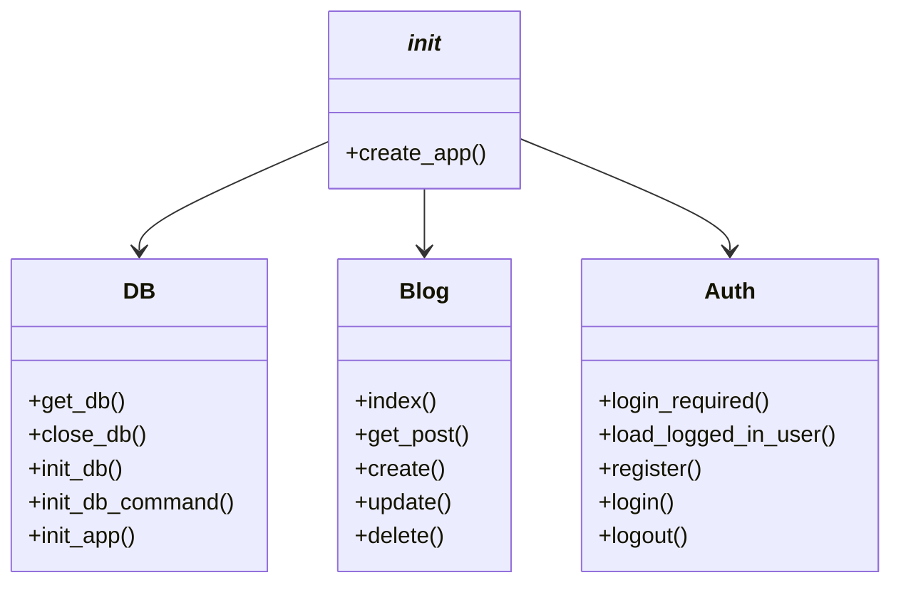
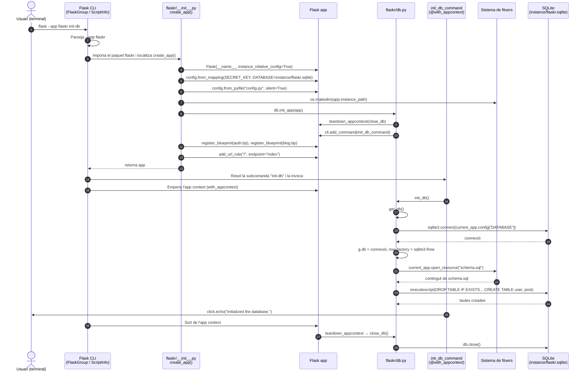
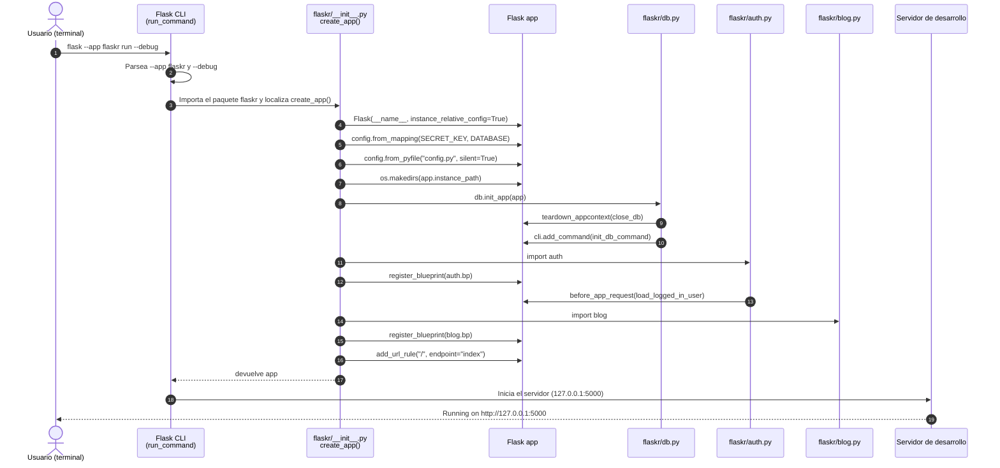
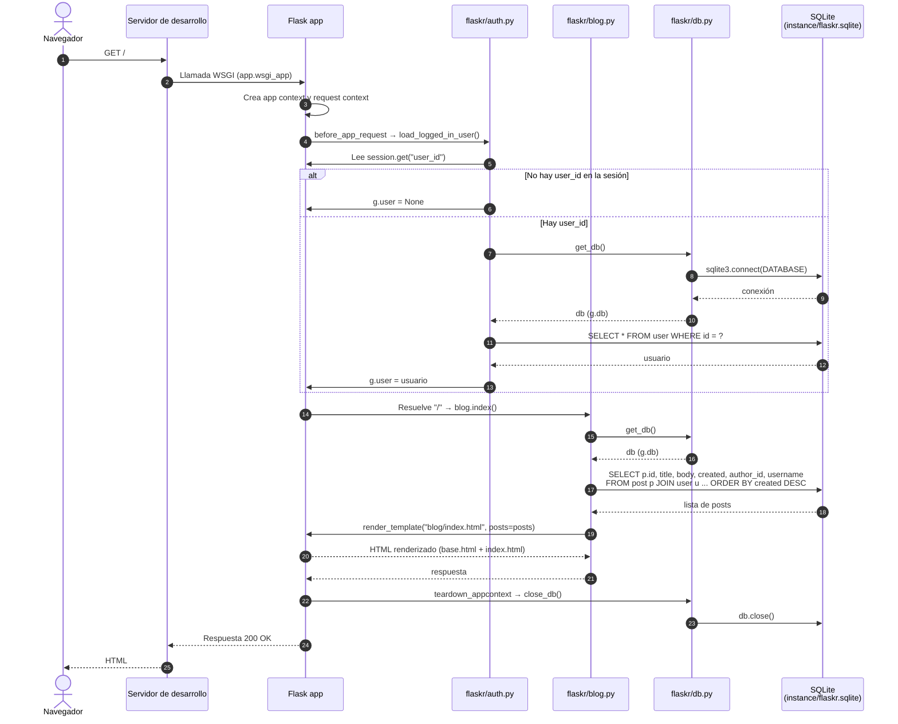

# Diagrama de Components

Descriure tots els components de l'aplicació

Components: db, _init_, auth, blog

## db
Descripció: funcions d'accés a BBDD
Mètodes:
- get_db(): Retorna connexió, metode que retorna la connexió a BBDD
- close_db(): Tanca la connexió a BBDD
- init_db(): Elimina les dades existents i crea noves taules
- init_db_command(): Fa un crit a init_db
- init_app(): Registra les funcions de la base de dades amb l'aplicació Flask

## blog
Descripció: Funcions de control de la aplicació
Mètodes:
- index(): Mostra totes les publicacions, per ordre de més recents
- get_post(): Agafa una publicació i al autor mitjançant el seu ID
- create(): Crea una nova publicació pel usuari actual
- update(): Actualitza una publicació si l'usuari es l'autor
- delete(): Elimina una clase

## auth
Descripció: Funcions d'inici de sessió
Mètodes:
- login_required(): Porta l'usuari al menú d'inici de sessió
- load_logged_in_user(): Inicia sessió automaticament si ja si ha iniciat abans
- register(): Registra nous usuaris
- login(): inicia sessió en un usuari ja registrat
- logout(): tanca la sessió actual

## _init_
Descripció: Funcions per a inicialitzar la aplicació
Mètodes:
- create_app(): Crea i configura la aplicació flask

# Diagrames de seqüencia 
## Diagrama init database

## Diagrama de arrencada de la app

## Diagrama de la petició get / login

