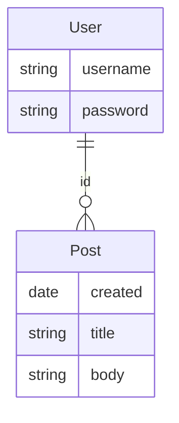

# Model de dades

## Model Entitat Relació E/R

| End-Point | Methods | Descripció |
| ----------- | ----------- | ---------|
| /Register | Get |
| /Register | Post |
| /Login    | Get |
| /Login    | Post |
| /Logout   | Get |
| /Create   | Get |
| /Create   | Post |
| /<int:id>/update | Get |
| /<int:id>/update | Post |
| /<int:id>/delete | Post |
| / | Get |
| /hello | Get |